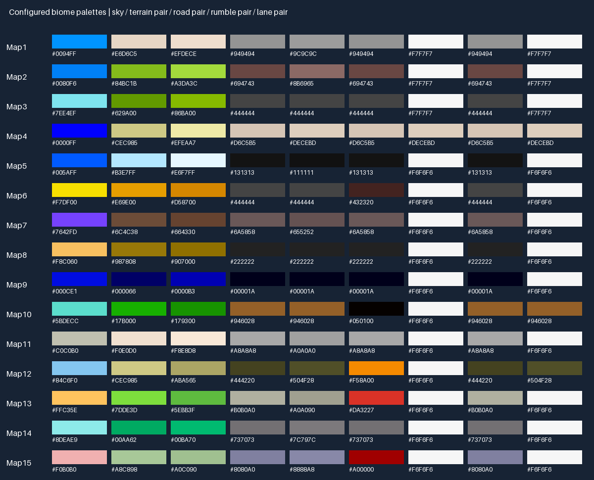
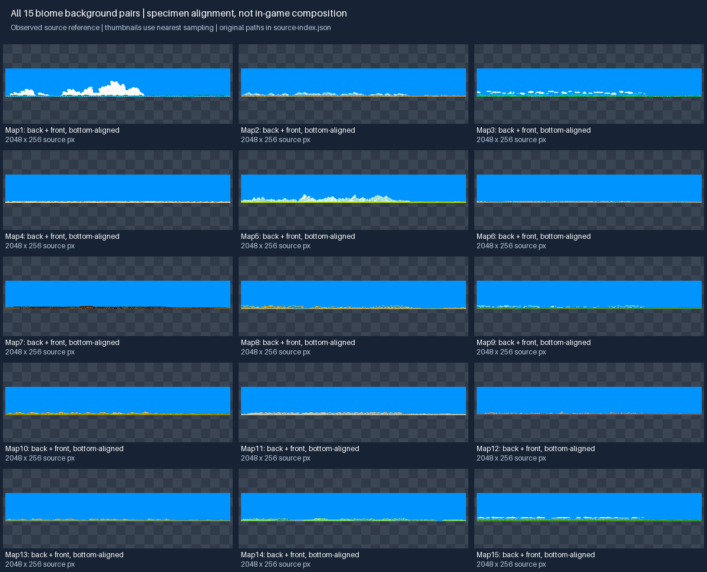
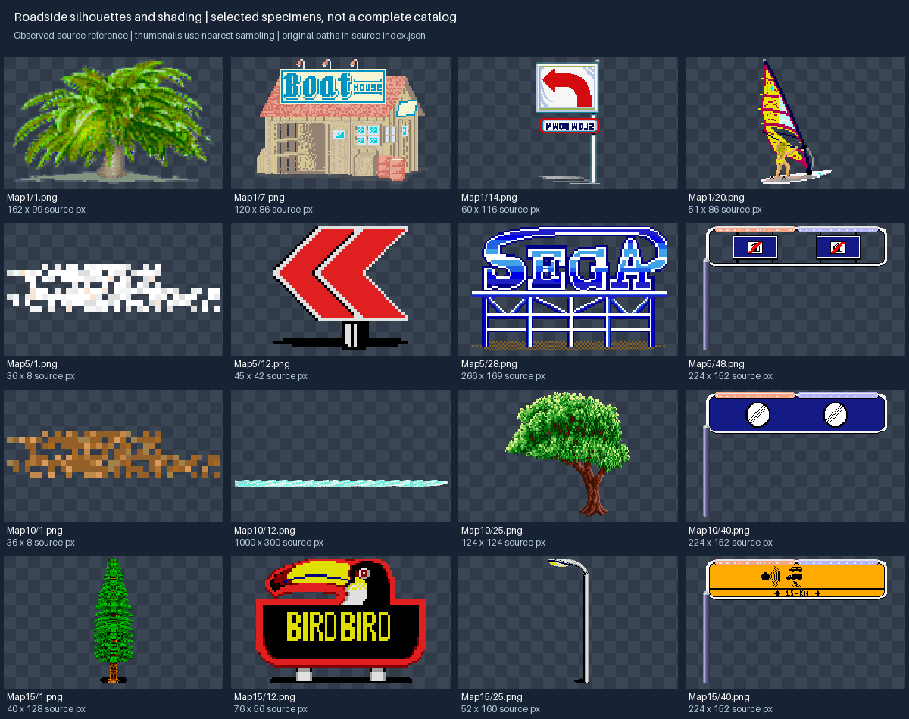

# Environment and biome art guide

Use numbered map IDs from the source rather than inventing official region names. The table
below gives exact configured sky, terrain and road colors. The interpretation column is an
art-production cue, not a source-authored biome name. Follow the
[overall art direction](art-direction.md) before producing a new set.

## Palette families



These hex values are RGB from each `Resources/Maps/MapLevels/MapN/map.txt`. Full RGBA values and
rumble/lane colors are in [source-index.json](references/source-index.json). Alternating pairs
are meaningful even when the two values happen to match.

| Map | Configured sky | Terrain pair | Road pair | Production cue, interpreted from color |
|---|---|---|---|---|
| 1 | `#0094FF` | `#E6D6C5` / `#EFDECE` | `#949494` / `#9C9C9C` | Bright sky, pale sand, neutral asphalt |
| 2 | `#0080F6` | `#84BC1B` / `#A3DA3C` | `#694743` / `#8B6965` | Lime terrain against a warm brown road |
| 3 | `#7EE4EF` | `#629A00` / `#86BA00` | `#444444` / `#444444` | Cyan sky, deep green ground, dark road |
| 4 | `#0000FF` | `#CEC985` / `#EFEAA7` | `#D6C5B5` / `#DECEBD` | Intense blue sky and low-contrast pale ground/road |
| 5 | `#005AFF` | `#B3E7FF` / `#E6F7FF` | `#131313` / `#111111` | Icy-light terrain and almost-black asphalt |
| 6 | `#F7DF00` | `#E69E00` / `#D58700` | `#444444` / `#444444` | Yellow sky and orange ground |
| 7 | `#7642FD` | `#6C4C38` / `#664330` | `#6A5858` / `#655252` | Purple sky, muted brown ground and road |
| 8 | `#F8C060` | `#987808` / `#907000` | `#222222` / `#222222` | Peach sky, ochre ground, dark road |
| 9 | `#000CE1` | `#000066` / `#0000B3` | `#00001A` / `#00001A` | Deep-blue terrain and very dark road |
| 10 | `#5BDECC` | `#17B000` / `#179300` | `#946028` / `#946028` | Turquoise sky, bright green ground, brown road |
| 11 | `#C0C0B0` | `#F0E0D0` / `#F8E8D8` | `#A8A8A8` / `#A0A0A0` | Muted sky and pale warm ground |
| 12 | `#84C6F0` | `#CEC985` / `#ABA565` | `#444220` / `#504F28` | Light-blue sky, olive ground and road |
| 13 | `#FFC35E` | `#7DDE3D` / `#5EBB3F` | `#B0B0A0` / `#A0A090` | Warm sky with vivid green ground and pale road |
| 14 | `#8DEAE9` | `#00AA62` / `#00BA70` | `#737073` / `#7C797C` | Pale-cyan sky, teal-green ground, gray road |
| 15 | `#F0B0B0` | `#A8C898` / `#A0C090` | `#8080A0` / `#8888A8` | Pink sky, muted green ground and lavender-gray road |

Do not sample final palette values from compressed GIFs. Also do not infer the configured sky
from the blue visible in the background specimen board: the source background PNGs and the
renderer/configured sky are distinct inputs. Preview a new prop against its map's actual colors.

## Background layers and horizons



**Observed:** each numbered map has `back.png` and `front.png`. Source loading enables texture
repetition for both. The inspected Map1 pair is 1536×256 and 2048×256 respectively; these are
examples, not a universal new-asset size. The board bottom-aligns layers only to show their
specimens; it does not reproduce their complete in-game placement, parallax or sky handling.

**Production rules:**

- Design the back layer as broad distant shapes and the front layer as a distinct nearer
  silhouette band. Keep their values/shapes distinguishable when scrolled together.
- Agree a horizon baseline and layer contact before painting. Match the existing family's
  placement metadata; do not bake the final HUD, road or player car into either layer.
- Make horizontal repetition intentional. Check the first/last columns, then view three repeats
  and the pair scrolling at different offsets. Hide neither a color discontinuity nor a large
  duplicated landmark at the wrap seam.
- Avoid a dense, high-contrast strip directly behind distant traffic or the fork decision.
  The road must remain readable over the horizon, especially in dark Map9 and pale Map4/11.
- Retain each layer's approved canvas, anchor and sky/alpha treatment on replacement. A new
  transparent horizon and an opaque old background cannot be swapped blindly.

## Roadside objects



**Observed specimens:** Map1 includes a broad palm (`1.png`, 162×99), a small structure
(`7.png`, 120×86), a turn sign (`14.png`, 60×116) and a narrow sail-shaped object (`20.png`,
51×86). Map10's inspected tree (`25.png`) is 124×124; Map15's narrow tree (`1.png`) is 40×128.
The examples demonstrate different silhouettes and source sizes; they are not a mandatory
object list for every biome.

For new work, start from the intended scale family: a narrow post, broad canopy, low ground
strip, building or large landmark. Preserve recognizable mass at middle/far distance. Use
large silhouette changes before adding tiny windows, leaves, text or repeated texture.

Keep road signs and checkpoint cues readable at speed. Decorative billboards can be bolder than
ordinary foliage, but should not resemble a turn cue or conceal traffic. Do not bake their
perspective scaling into the image; a world sprite is placed and projected by the renderer.

## Contact, anchoring and collision

**Observed:** object properties support independent left/right visual pivots, collision pivots,
collision width, scale and terrain flags. These are separate from the visible PNG canvas.

**Production rules:**

- Mark the real contact point (trunk base, sign feet, wheel/ground line or building base) in the
  brief and delivery metadata. Transparent padding must not move that contact point.
- Keep visual and collision anchors separate. A wide canopy need not collide across its full
  silhouette; a sign's shadow must not become a solid obstacle.
- Do not mirror a directional sign to produce its opposite side. Author readable left/right
  variants when the message or perspective requires them.
- Keep shadow, ground strip and elevated detail on clearly identified layers where independent
  clipping is needed. Test the intended asset clipped behind a crest, not just isolated.
- Replacing or trimming art must not change authored gameplay bounds or the chance of crashing.

## Placement rhythm and fork transitions

Place repeating small props outside the driveable corridor and use occasional large landmarks
to punctuate the route. Alternate visual masses rather than repeating an obvious identical
tree at the same spacing for the entire drive. Keep collision placement under gameplay control;
art dressing must not silently narrow a lane.

For a fork, inspect both arms together. Place major signs before the decision, keep the split
opening visible and avoid a large central prop that looks like a third route. A foreground
object should not jump to a new palette or position when a background transition begins.

For biome transitions, prepare an A/B preview with road colors, both background layers, shared
traffic, player car and HUD. Inspect the beginning, midpoint and end of the transition, then
drive it. Palette/background motion follows authoritative progress; art animation must not
decide which route or checkpoint the player receives.

## Environment creation brief

```text
Map ID / new biome working name:
Gameplay role (background, repeated dressing, landmark, sign, obstacle):
Source specimens and neighboring asset family:
Sky, terrain pair, road pair and relevant lane/rumble colors:
Silhouette and material ramps:
Native canvas and contact point:
Visual pivots / collision metadata handled separately:
Near/mid/far use and required left/right variants:
Wrap seam and horizon baseline (backgrounds only):
Transition partner and preview scenario:
```

## Review checklist

- Exact configured colors are recorded; geography and working names are labeled as proposals.
- Both background layers work alone, together and repeated horizontally.
- Road, traffic and turn/checkpoint cues remain distinct over the destination palette.
- Near/mid/far scaling keeps silhouettes readable without shimmer or white/dark alpha fringes.
- Contact points and visual/collision pivots remain stable after import or trim.
- Hill clipping and both fork arms are checked with the new art in the scene.
- Transition start/mid/end and movement are inspected with the actual HUD and controls.
- Only the required biome/selected asset groups need to be resident; avoid one giant all-biome
  sheet merely for convenient art delivery.
