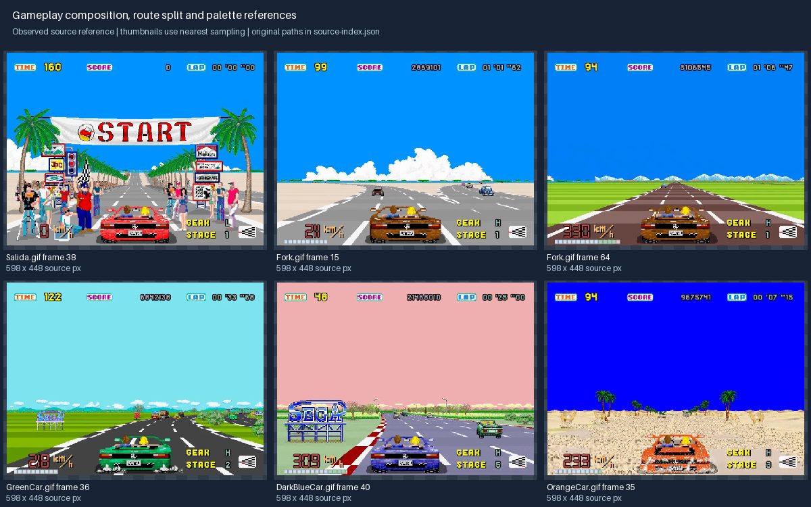

# OutRun art production guides

Create new art that belongs to the game rather than a generic retro-racing collection. These
guides use inspected artwork and gameplay GIF frames from source commit
`6882721c99bc79365f815f68d389bf5078129e68`. They distinguish **observed source characteristics**
from **proposed production conventions** for the internal mobile + web landscape migration.
They do not import runtime art, implement a UI, or claim that new assets have been approved.

## Start here

| Creating or changing | Read |
|---|---|
| Any art | [Art direction](art-direction.md) and [creation brief](creation-brief.md) |
| Biome, sky, background or roadside prop | [Environment guide](environments.md) |
| Import or deliver Map2–15/goal runtime art | [Destination environment delivery](destination-environments.md) |
| Player car, traffic vehicle, wheel effect or animation | [Vehicles and animation](vehicles-animation.md) |
| HUD, button, route symbol, menu or control | [UI and HUD](ui-hud.md) |
| Export, manifest, pivot, atlas or engine import | [Asset delivery](asset-delivery.md) |

Before generating or commissioning art, select the approved source family, native/logical size,
pivot, palette and required states in the brief. Review an anchor asset before expanding a
family. Keep animation identity and ground contact stable; assess distance readability in the
projected scene, not just on a zoomed-in canvas.

## Visual references

| Board | Purpose |
|---|---|
| [Gameplay](references/gameplay.png) | Composition, open sky, road depth, forks, car/HUD hierarchy |
| [All biome background pairs](references/biomes.png) | 15 numbered panorama families; specimen assembly, not an in-game composite |
| [Configured palettes](references/palettes.png) | Exact RGB swatches from map configuration, with full RGBA in the index |
| [Roadside props](references/props.png) | Selected silhouettes, edge/shade treatment and native dimensions |
| [Vehicles](references/vehicles.png) | Pose/shape/scale variation at labeled source dimensions |
| [Wheel effects](references/effects.png) | Separate effect sprites and alpha edges |
| [UI samples](references/ui.png) | Label color roles and the source's mixed menu treatments |
| [Landscape layout proposal](references/landscape-layout.svg) | New mobile composition; not a source screenshot or an implemented screen |

[Source index](references/source-index.json) records the commit, specimen paths, zero-based GIF
frame numbers, image dimensions and configured biome colors. Paths are relative to the source
repository's Resources directory. Checkerboards, labels and layout diagrams are guide overlays,
not sprite content. Thumbnails use nearest sampling, may be resized to fit, and do not define
production pixel sizes. Background pairs are bottom-aligned for inspection only; actual game
projection, cropping and palette transitions must be evaluated in-engine.



## Rebuild the reference boards

Use a local checkout of the pinned source and Python with Pillow (boards were built with
Pillow 11.3.0). No engine installation is needed. The generator rejects another source commit
and tracked modifications under Resources, so changed artwork cannot inherit the pinned label.

```sh
python3 docs/art/build_references.py --source /path/to/OutRun
```

The script writes seven PNG boards and source-index.json under references/. It does not alter
source files or copy the full asset library. Regeneration should be reviewed visually; changing
reference artwork requires an explicit source/family decision, not automatic baseline approval.
The SVG layout proposal is authored separately and is not overwritten by that script.

Validate guide links, PNG board headers, the SVG and palette-table consistency without Pillow
or the engine. Add --source to compare all recorded specimen dimensions and map RGBA values
against the pinned checkout. Source comparison also rejects tracked Resources modifications:

```sh
python3 docs/art/validate_references.py
python3 docs/art/validate_references.py --source /path/to/OutRun
```

## Applying the guides

Art-production PRs should link their brief, relevant guide and reference family. Review native
pixels, approved projected sizes, alpha edges, pose/anchor consistency and mobile readability.
Once art enters the game, use the workflow's affected render/cooked checks, native previews and
browser mobile-size/touch emulation with safe-area and phone-low residency checks. Physical-phone
testing is outside this fast-iteration workflow. Documentation boards and the layout diagram have
no runtime rendering cost; mobile memory/draw budgets remain targets for future imported assets,
and desktop/emulated observations do not establish hardware frame time or thermal performance.

These guides belong to issue #26. PR #1 carries the development harness and landscape config;
commands requiring that harness apply after it lands. The guide-only branch starts from the
current develop baseline and changes no game settings or simulation behavior.
