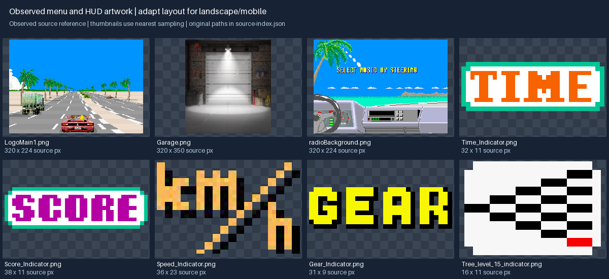
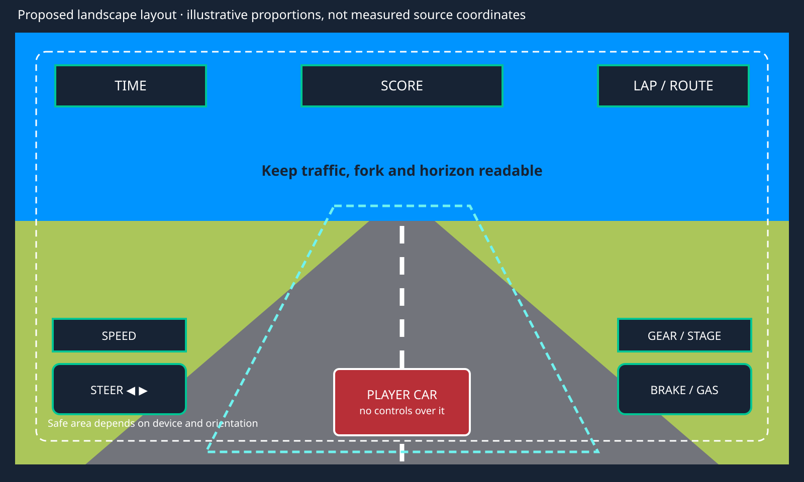

# UI and HUD art guide

Use this guide for new interface art and layouts. Read [art direction](art-direction.md),
[delivery requirements](asset-delivery.md) and the [creation brief](creation-brief.md) first.
The visual references are evidence from the pinned source; the mobile layout below is a
proposed production convention, not a screenshot of an implemented screen.

## Observed source language

The race HUD uses compact, hard-edged uppercase labels, strongly separated colors, dark
outlines/shadows and small route-tree symbols. TIME/SCORE/LAP sit along the top in the sampled
race captures; speed is lower-left, gear/stage lower-right, and the car occupies bottom-center.
See [gameplay references](references/gameplay.png). The original 598x448 GIF captures and
320x224 menu backgrounds are source sizes, not our landscape reference resolution.

Exact dominant opaque colors measured from the source label images:

| Role | Source color | Source file under Resources |
|---|---|---|
| TIME lettering | `#F76300` | Huds/HudRound/Time_Indicator.png |
| SCORE lettering | `#B500A4` | Huds/HudRound/Score_Indicator.png |
| TIME/SCORE trim | `#00C594` and white | Same two files |
| Gear/stage lettering | `#F7F700`, black shadow | Huds/HudRound/Gear_Indicator.png and Stage_Indicator.png |

The radio menu uses an illustrated dashboard over a coastal pixel landscape. The car-selection
Garage.png is a more photographic shaded scene. This is a mixed source menu treatment: it is
not evidence that photoreal textures belong on the road, cars or every new interface element.

## Rules for new UI art

Retain the arcade label shapes and clear color roles. Prefer a small coordinated set of
pixel-edged badges, arrows, gear symbols and route nodes. A new button must belong to the same
family in normal, held, selected, disabled and focus states. Use outline, fill/value and shape
changes together; do not communicate a control state through hue alone.

Use live text for changing values, button labels, settings and ranking names. Keep text out of
new background illustrations and generated button artwork. A static label sprite can remain
when intentionally matching the source, but never bake speed/time/score digits into it. Font
selection, integer scaling and fallback behavior need an actual small-screen preview; avoid
thin strokes and tiny decorative text. The starter default font is not automatically the final
arcade typography choice.

World art should stay visibly crisp. UI can use engine-rendered text and simple shapes at the
screen's resolution; it must harmonize with the sprites without requiring every glyph to use
an identical world-pixel grid. Do not add scanlines, bloom, glass panels, neon gradients or
continuous glows merely because the game is retro.

## Proposed landscape composition

This diagram is a layout brief. It is not a completed UI document or a proven camera fit.
Keep a top information band, a visible central road/fork corridor and an unobstructed player
car at bottom-center. Place steering and pedals at lower side areas, with speed and gear
readouts above their respective control areas. On tablets and narrower browser windows,
reflow those areas instead of squeezing controls over the car or critical traffic.

Design against logical UI points and the safe area, never a literal 1920-pixel device screen.
The migration targets a 1920x1080 landscape design reference; at this branch's develop base,
the starter configuration is still portrait and PR #1 carries the landscape update.
Test 882x344, 852x393, 1080x810, 1280x720 and 720x540 logical layouts. Include rotated notch/home
insets in both landscape orientations. These are validation sizes, not art canvas sizes.

- Touch hit areas must be at least 9 mm in the engine's physical touch model; the icon can be
  visually smaller. Do not equate 50 source-image pixels with a universal physical size.
- Held steer and pedal states must remain readable under a finger and allow simultaneous use.
- Decorative frames cannot consume the clear central road view or conceal a fork decision.
- A pause/result panel must visibly separate itself and block the driving controls underneath.
- A touch-free web/keyboard layout can omit touch buttons without rearranging race information
  unpredictably. Resize must not crop the car, critical readouts or active modal actions.

## Art component set

| Component | Artist delivers | Engine/UI owns |
|---|---|---|
| Stat badge | Frame, icon and optional static title at approved native size | Value, layout, text and urgency state |
| Steering control | Left/right icon family and held/disabled variants | Hit target, multi-touch input, cancellation |
| Pedal control | Acceleration/brake symbols and held/disabled variants | Action binding and recorded press/release |
| Route map | Node/edge/goal symbols with current/visited/available states | Graph construction and progression |
| Pause/results | Frame pieces, header ornament and action icons | Modal blocking, score/time values and navigation |
| Selection screen | Separately layered scenery, car stand and frame pieces | Car/mode lists, focus/selection, labels and input |

Make reusable frames 9-slice candidates with explicit border/body/content annotations; do not
stretch detailed corners or paint a separate huge image for every button size. Author all new
screens/widgets with `gameengine ui doc`; this guide does not authorize handwritten UI JSON.

## Animation and review

Use short entrance, selection, checkpoint and result bursts, then settle. Urgent time feedback
may pulse while urgent; idle menus should not animate indefinitely. Check animated UI at its
last frame as well as mid-transition. Art timing never decides when a race ends or a bonus is
awarded.

Review at real small-screen size, not only zoomed in: can the player read time, speed and gear
against bright sky, snow, dark road and dense scenery? Can both thumbs hold controls without
hiding traffic? Are focus, held, disabled and modal states visually distinct? Inspect all
landscape sizes and safe areas in native previews and browser mobile-size/touch emulation when
the UI exists. Exercise simultaneous held controls, cancellation and focus loss there; no
physical-phone run is required for this fast-iteration workflow. These checks are future
implementation acceptance, not coverage claimed by this guide, and do not measure device speed.
