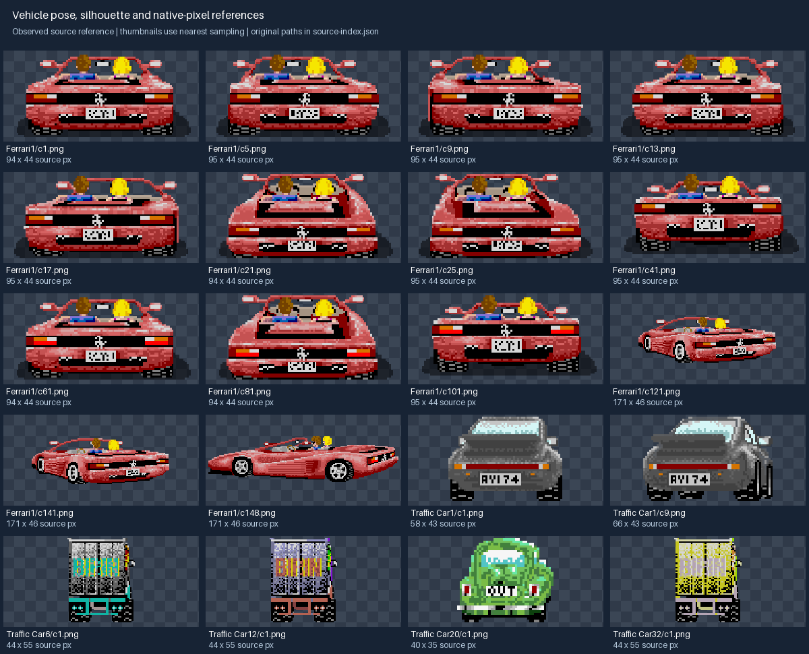
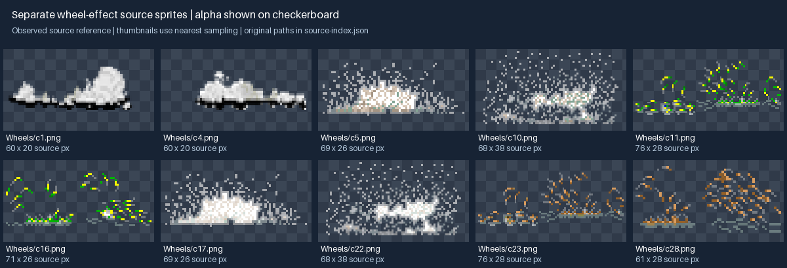

# Vehicles and animation guide

Use this guide with [art direction](art-direction.md) and the [asset delivery contract](asset-delivery.md).
The reference is the inspected OutRun source at `6882721c99bc79365f815f68d389bf5078129e68`.
The frame tables below describe that source. Recommendations for newly made assets are marked
as production conventions; they do not claim an existing engine importer or animation schema.



## What the source establishes

The player is a low, wide, open-top sports car viewed primarily from behind. Its rear light bar,
dark tires/underbody, bright upper body and two small occupant silhouettes make it recognizable
at speed. Steering and elevation change the view; crash and arrival poses expose much more of
the side. The artwork uses visible pixel clusters, sharp highlights, dark contour/shadow patches
and some noisy/dithered surface detail. It is more detailed than a flat icon and does not impose
a single small palette across the whole game.

Traffic varies deliberately in silhouette and height: saloons, rounded compact cars, trucks and
buses. Give an obstacle a recognizable mass before adding badges, windows or tiny trim. The
truck and car samples are not scaled to a common production canvas in the reference board.

Measured specimen sizes illustrate why image width cannot be a gameplay collider:

| Specimen | Source pixels |
|---|---:|
| Player `Ferrari1/c1.png` | 94 × 44 |
| Player `Ferrari1/c9.png` | 95 × 44 |
| Player `Ferrari1/c121.png` | 171 × 46 |
| Traffic `Car1/c1.png` | 58 × 43 |
| Traffic `Car1/c9.png` | 66 × 43 |
| Traffic `Car6/c1.png` | 44 × 55 |

For the inspected Ferrari1 body set, all 148 frames have one of four sizes: 94 × 44,
95 × 44, 96 × 44 or 171 × 46. These are source measurements, not mandatory dimensions for
every future vehicle. [Source index](references/source-index.json) identifies the board samples.

## Production conventions for new vehicles

- Match the approved rear-view reference first. Keep the rear axle/contact baseline, body
  proportions, occupant placement and scale stable when adding turn and slope poses.
- Design highlights as coherent upper-body planes. Keep a strong dark underside and tire
  separation so the car remains readable over light sand, gray asphalt and dark roads.
  Match lighting across its own sequence; the references do not establish one universal
  measured light angle for every source asset.
- Use painted ramps and pixel clusters instead of a smooth modern 3D render, broad glossy
  bloom, or independently changing reflections in each frame. Do not introduce a neon
  outline around every vehicle.
- Preserve the same car between views: wheelbase, spoiler, lamps, windshield and occupant
  colors must not change during steering. Turning should reveal a consistent side, not
  stretch the neutral frame or move its emblem arbitrarily.
- Use a common logical canvas and explicit ground anchor for an animation family, or retain
  per-frame source sizes with offsets into that canvas. Wider crash poses need room; never
  squash them to the neutral frame's width. Trimmed atlas rectangles are a separate concern.
- Separate body, left/right ground effects and UI decorations. Do not bake smoke, road,
  contact labels or a large background into every body frame.
- Recolor material ramps coherently: preserve distinct paint, glass, tires, skin/clothing and
  highlights. A paint variant must retain contrast on every biome palette, not merely change
  the brightest red pixels.

## Source player frame families

`cN` below means the one-based body filename, not the index of the C++ texture vector.
`Vehicle.cpp` loads 148 body textures, then appends 28 shared wheel-effect textures.
`PlayerCar::drawPlayRound` selects these body ranges:

| Action and elevation | Straight | Left entry; held loop | Right entry; held loop |
|---|---|---|---|
| Accelerate/boot, flat | c1–c4 | c5–c12; c9–c12 | c13–c20; c17–c20 |
| Accelerate/boot, uphill | c21–c24 | c25–c32; c29–c32 | c33–c40; c37–c40 |
| Accelerate/boot, downhill | c41–c44 | c45–c52; c49–c52 | c53–c60; c57–c60 |
| Brake, flat | c61–c64 | c65–c72; c69–c72 | c73–c80; c77–c80 |
| Brake, uphill | c81–c84 | c85–c92; c89–c92 | c93–c100; c97–c100 |
| Brake, downhill | c101–c104 | c105–c112; c109–c112 | c113–c120; c117–c120 |

| Other source state | Body frames |
|---|---|
| Moving crash, left-to-right mode | c121–c128 |
| Stopped reaction, same mode | c129–c133 |
| Moving crash, opposite mode | c134–c141 |
| Stopped reaction, opposite mode | c142–c146 |
| Additional arrival-drift poses | c147–c148; arrival also reuses other body poses |
| No-action hold | c1 flat, c21 uphill, c41 downhill |

Start and arrival routines sometimes address the vector directly with zero-based indices.
For example, arrival indices 146/147 refer to c147/c148, not c146/c147. Export semantic
names and verify each state against the source instead of carrying mixed index arithmetic
into a new manifest.

## Source traffic and effect families

Each source traffic vehicle loads 16 body frames. In `TrafficCar::draw`, direction names
are the source enum names; verify which visible side is shown before labeling new yaw poses.

| Traffic state | Source TURNRIGHT | Source TURNLEFT |
|---|---|---|
| Flat, player close | c1–c2 | c3–c4 |
| Uphill | c5–c6 | c7–c8 |
| Downhill | c9–c10 | c11–c12 |
| Flat, player far | c13–c14 | c15–c16 |



The separate `Vehicles/PlayerCar/Wheels` filenames map as follows:

| Effect | Source filenames | Visual treatment |
|---|---|---|
| Smoke | c1–c4 | White/gray clustered puffs, dark ground edge |
| Sand | c5–c10 | Pale granular spray |
| Grass | c11–c16 | Bright green fragments and short streaks |
| Snow | c17–c22 | White icy granular spray |
| Mud | c23–c28 | Brown/orange fragments and streaks |

The source catalog has 14 selectable player cars, 148 body frames per player set, 28 shared
wheel-effect files, and 32 traffic variants with 16 frames each. This describes migration
coverage, not a requirement to generate all of it before the first playable slice.

## Stage the art work with the prototype

For the road proof, one approved rear vehicle pose and a few traffic/prop silhouettes are
enough to judge scale and clipping. For the first driving slice, cover every implemented
straight/left/right, slope and brake state; declare temporary reuse explicitly. Add the
crash, recovery and terrain-effect sets when those behaviors land. Full parity then covers
the source families and complete catalog above.

Approve the neutral car and its anchor before producing sequences. Create one turn, one
slope and one wide crash pose next; compare them in motion. Only then expand the sequence
and color variants. Do not commission a full sheet of unrelated generated images and expect
the engine to repair their scale, wheels, lighting or character continuity.

Animation timing is a separate manifest decision. Express sequence duration/looping and
state transitions explicitly. The simulation decides crash duration, recovery and control
unlock; a missing sprite or slower display cannot prolong a crash. Freeze/resume visuals
from the same authoritative pause state. The old draw-counter increments are reference
behavior to calibrate, not a new simulation clock.

## Vehicle creation brief

Copy and complete this brief before drawing or generating a vehicle:

```text
Asset ID and ticket:
Role: player / traffic / arrival-only
Approved reference pose and palette:
Silhouette: body height/width, axle locations, roof/open-top, distinctive features
Views/states required now; states explicitly deferred:
Source-frame mapping or semantic frame names:
Logical canvas, ground anchor, per-frame offsets:
Paint/glass/tire/occupant ramps and lighting reference:
Body/effects separation and frame order:
Loop/duration proposal; sim-owned transition boundaries:
Smallest expected in-game size and test biome backgrounds:
Deliverables: editable master, transparent PNGs, manifest, contact sheet, animation preview
```

For an image-generation brief, attach the approved pose and say: “Preserve this exact vehicle,
pixel-cluster treatment, palette, proportions and ground anchor; produce the specified next
view/state on transparency, with no scene, labels or baked smoke.” Specify the desired view
in visual terms rather than trusting LEFT/RIGHT enum names. Generated output still passes
the same cleanup and sequence review as hand-drawn output.

## Acceptance checks

- Flip through frames over a fixed crosshair and ground line: no unintended axle/anchor jump,
  body breathing, changing occupant, detached tire, missing alpha or inconsistent silhouette.
- View at native resolution, enlarged with nearest sampling, and at the smallest intended
  in-game size over light and dark biome colors. Check legibility, not just enlarged detail.
- Review left/right entry, held turn, uphill/downhill, brake, crash, stopped recovery and the
  last arrival frame. Check effect attachment separately for each wheel.
- Check frame references, logical offsets and collision metadata before and after atlas
  trimming. Visual packing changes must not alter collisions or sequence duration.
- Once the implementation and harness from PR #1 exist, use focused `vehicle.*`/`collision.*`
  tests, T1 animation samples, cooked loading and the selected PR gate. A guide alone does
  not prove those behaviors; this documentation branch does not contain that harness yet.

Source evidence: [Vehicle.cpp](https://github.com/ZgzInfinity/OutRun/blob/6882721c99bc79365f815f68d389bf5078129e68/src/Car/Vehicle/Vehicle.cpp),
[PlayerCar.cpp](https://github.com/ZgzInfinity/OutRun/blob/6882721c99bc79365f815f68d389bf5078129e68/src/Car/PlayerCar/PlayerCar.cpp),
[TrafficCar.cpp](https://github.com/ZgzInfinity/OutRun/blob/6882721c99bc79365f815f68d389bf5078129e68/src/Car/TrafficCar/TrafficCar.cpp),
[Globals.h](https://github.com/ZgzInfinity/OutRun/blob/6882721c99bc79365f815f68d389bf5078129e68/src/Globals.h).
